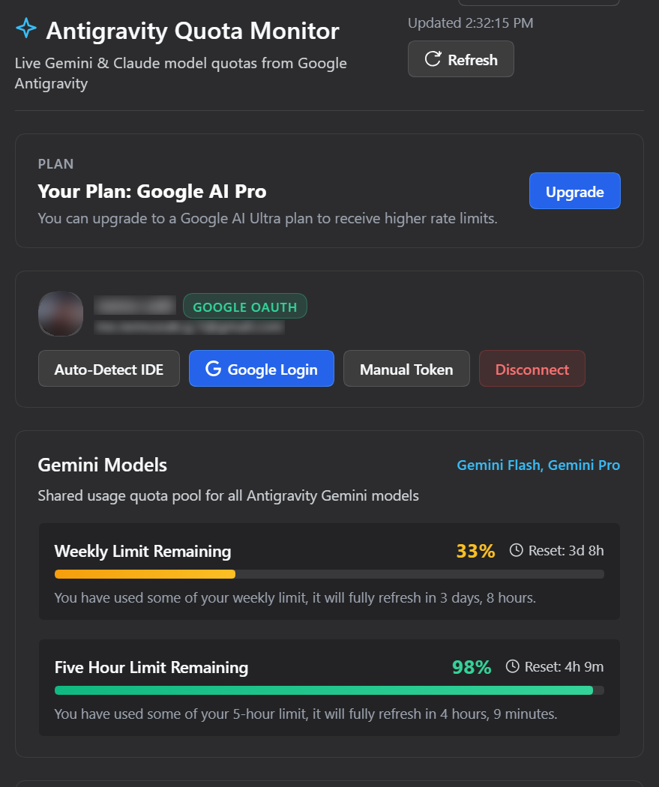
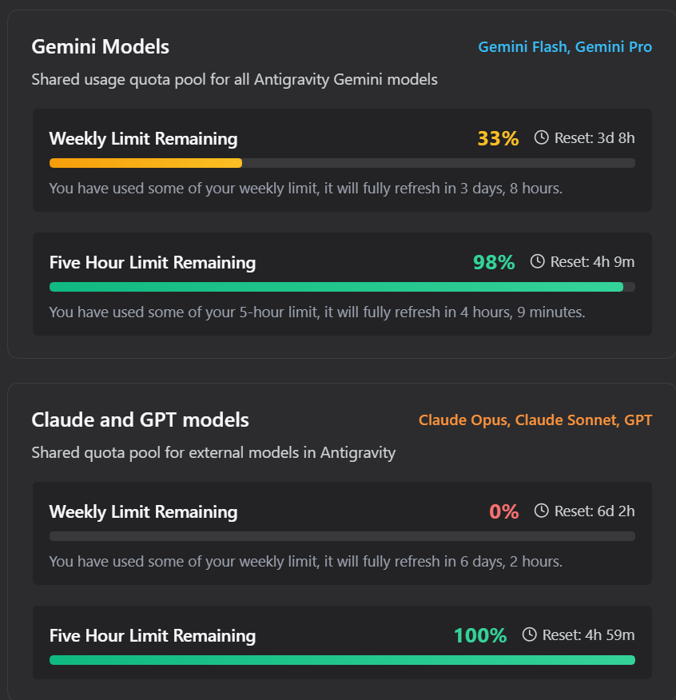

<div align="center">

# 📊 dsh-agy-gemini-quota

**DeepSeek Harness × Google Antigravity — Real-time Gemini & Claude Quota Monitor**

[](LICENSE)
[](package.json)
[](https://github.com/nursatechstudio/dsh-agy-gemini-quota)
[](https://dsh-plugin.org/plugins/nursatechstudio/dsh-agy-gemini-quota)
[](https://github.com/nursatechstudio/dsh-agy-gemini-quota)

🌐 **Language**: [English](README.md) · [Bahasa Indonesia](README.id.md)

---

</div>

DeepSeek Harness plugin for Antigravity Gemini quota monitoring in Settings submenu `agy-quota`.

## 📸 Preview

<div align="center">
  
  <br/><br/>
  
</div>

## ✨ Features

- **Live Gemini Quota**: Weekly and 5-Hour rolling limits with visual progress bars, percentage, and reset time countdown.
- **Claude & 3P Quota**: Tracks third-party quota bucket (Claude Opus/Sonnet/GPT).
- **Multiple Login Methods**:
  1. **Auto-Detect IDE**: Automatically reads OAuth credentials from local Antigravity IDE state.
  2. **Google Login**: One-click Google OAuth flow from the settings page.
  3. **Environment / .env**: Supports `AGY_REFRESH_TOKEN` or `AGY_ACCESS_TOKEN`.
  4. **Manual Token**: Paste refresh token (`1//...`) or access token (`ya29...`) in the UI.
- **Settings Submenu**: Integrates directly into DSH Settings sidebar under `agy-quota`.

## 📦 Installation

### 1. Install via DSH CLI

From NPM (recommended for DSH Plugin Hub):
```bash
dsh plugin --profile web add dsh-plugin-agy-quota
```

From GitHub:
```bash
dsh plugin --profile web add github:nursatechstudio/dsh-agy-gemini-quota
```

Or from a local directory (development):
```bash
dsh plugin --profile web add ./path/to/dsh-agy-gemini-quota
```

### 2. Verify Installation

Inspect composed profile bundle layer:
```bash
dsh --profile web --dump-config
```

### 3. Uninstall

```bash
dsh plugin --profile web remove dsh-plugin-agy-quota
```

## ⚙️ Configuration (Optional)

If running in headless mode or without Antigravity IDE installed on the same machine:

```bash
cp .env.example .env
```

Set either `AGY_REFRESH_TOKEN` or `AGY_ACCESS_TOKEN` in `.env`:
```env
AGY_REFRESH_TOKEN=1//...
```

*Note: Never commit `.env` or sensitive credentials to Git.*

## 📄 License

[MIT](LICENSE)
